<!-- Perfil de GitHub de Manuel Osvaldo Montes Blancarte · estilo blancarte.lat
     Las imágenes cambian solas entre versión clara y oscura según el tema de GitHub de quien lo vea. -->

<a href="https://blancarte.lat">
  <picture>
    <source media="(prefers-color-scheme: dark)" srcset="assets/banner-oscuro.svg">
    
  </picture>
</a>

  

<picture>
  <source media="(prefers-color-scheme: dark)" srcset="assets/titulo-sobre-oscuro.svg">
  
</picture>

<table>
  <tr>
    <td valign="top" width="43%">
      <picture>
        <source media="(prefers-color-scheme: dark)" srcset="assets/ascii-oscuro.svg">
        
      </picture>
    </td>
    <td valign="top" width="57%">
      <picture>
        <source media="(prefers-color-scheme: dark)" srcset="assets/info-oscuro.svg">
        
      </picture>
    </td>
  </tr>
</table>

Desarrollo aplicaciones web completas —interfaz, API, base de datos y servidor Linux— y modelos de IA de visión por computadora. También soy baterista y productor.
Diseñé la IA de un traductor del abecedario de Lengua de Señas Mexicana (salió en la Gaceta UdeG), y mi portafolio tiene un océano en tiempo real hecho con shaders: **[blancarte.lat](https://blancarte.lat)**

<picture>
  <source media="(prefers-color-scheme: dark)" srcset="assets/titulo-proyectos-oscuro.svg">
  
</picture>

  <a href="https://lsm.aquora.dev"><picture><source media="(prefers-color-scheme: dark)" srcset="assets/proy-hi-oscuro.svg"></picture></a>
  <a href="https://uniaccess.aquora.dev"><picture><source media="(prefers-color-scheme: dark)" srcset="assets/proy-uniaccess-oscuro.svg"></picture></a>
  <a href="https://demo-renta.blancarte.lat"><picture><source media="(prefers-color-scheme: dark)" srcset="assets/proy-rentas-oscuro.svg"></picture></a>
  <a href="https://nexus.aquora.dev/login.html"><picture><source media="(prefers-color-scheme: dark)" srcset="assets/proy-nexus-oscuro.svg"></picture></a>
  <a href="https://blancarte.lat/trabajo"><picture><source media="(prefers-color-scheme: dark)" srcset="assets/proy-servidor-oscuro.svg"></picture></a>
  <a href="https://sis.aquora.dev"><picture><source media="(prefers-color-scheme: dark)" srcset="assets/proy-sis-oscuro.svg"></picture></a>

<picture>
  <source media="(prefers-color-scheme: dark)" srcset="assets/titulo-stack-oscuro.svg">
  
</picture>

<picture>
  <source media="(prefers-color-scheme: dark)" srcset="https://skillicons.dev/icons?i=js,py,mysql,ts,html,css,react,nextjs,vite,tailwind,nodejs,express&theme=dark&perline=12">
  
</picture>
 
<picture>
  <source media="(prefers-color-scheme: dark)" srcset="https://skillicons.dev/icons?i=fastapi,pytorch,opencv,sqlite,linux,ubuntu,nginx,cloudflare,git,github,githubactions,vscode&theme=dark&perline=12">
  
</picture>

<picture>
  <source media="(prefers-color-scheme: dark)" srcset="assets/titulo-actividad-oscuro.svg">
  
</picture>

  <picture>
    <source media="(prefers-color-scheme: dark)" srcset="assets/contrib-oscuro.svg">
    
  </picture>

<picture>
  <source media="(prefers-color-scheme: dark)" srcset="assets/titulo-contacto-oscuro.svg">
  
</picture>

<picture>
  <source media="(prefers-color-scheme: dark)" srcset="assets/ola-oscuro.svg">
  
</picture>
