<!-- Perfil de GitHub de Manuel Osvaldo Montes Blancarte · estilo blancarte.lat
     Las imágenes cambian solas entre versión clara y oscura según el tema de GitHub de quien lo vea. -->

<a href="https://blancarte.lat">
  <picture>
    <source media="(prefers-color-scheme: dark)" srcset="assets/banner-oscuro.svg">
    
  </picture>
</a>

<picture>
  <source media="(prefers-color-scheme: dark)" srcset="assets/titulo-sobre-oscuro.svg">
  
</picture>

<picture>
  <source media="(prefers-color-scheme: dark)" srcset="assets/sobre-oscuro.svg">
  
</picture>

Más de mí y mis proyectos a detalle en <a href="https://blancarte.lat"><b>blancarte.lat</b></a>

<picture>
  <source media="(prefers-color-scheme: dark)" srcset="assets/titulo-proyectos-oscuro.svg">
  
</picture>

  <a href="https://lsm.aquora.dev"><picture><source media="(prefers-color-scheme: dark)" srcset="assets/proy-hi-oscuro.svg"></picture></a>
  <a href="https://uniaccess.aquora.dev"><picture><source media="(prefers-color-scheme: dark)" srcset="assets/proy-uniaccess-oscuro.svg"></picture></a>
  <a href="https://demo-renta.blancarte.lat"><picture><source media="(prefers-color-scheme: dark)" srcset="assets/proy-rentas-oscuro.svg"></picture></a>
  <a href="https://nexus.aquora.dev/login.html"><picture><source media="(prefers-color-scheme: dark)" srcset="assets/proy-nexus-oscuro.svg"></picture></a>

<picture>
  <source media="(prefers-color-scheme: dark)" srcset="assets/titulo-stack-oscuro.svg">
  
</picture>

<picture>
  <source media="(prefers-color-scheme: dark)" srcset="assets/stack-oscuro.svg">
  
</picture>

<picture>
  <source media="(prefers-color-scheme: dark)" srcset="assets/titulo-actividad-oscuro.svg">
  
</picture>

  <picture>
    <source media="(prefers-color-scheme: dark)" srcset="assets/contrib-oscuro.svg">
    
  </picture>

<picture>
  <source media="(prefers-color-scheme: dark)" srcset="assets/titulo-contacto-oscuro.svg">
  
</picture>

<picture>
  <source media="(prefers-color-scheme: dark)" srcset="assets/ola-oscuro.svg">
  
</picture>
